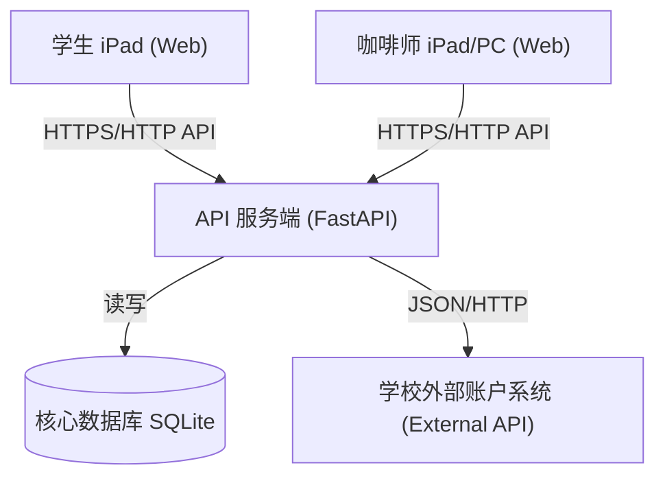

# 系统架构设计文档 (System Architecture)

## 1. 架构总览 (Overview)
本系统采用经典的 **B/S (Browser/Server)** 架构，在此基础上引入 **实时推送服务** 以满足快速接单需求。系统设计遵循 **前后端分离** 原则。

## 2. 核心模块详解

### 2.1 表现层 (Presentation Layer)
*   **学生端 (Student App)**
    *   **功能**：菜单渲染、购物车逻辑、支付动作发起。
    *   **特点**：极简交互，重点优化 `Touch` 事件，避免点击延迟。
    *   **静态资源**：菜单图片直接由 API 服务器托管 (`/static` 目录)，减少外部依赖。
*   **咖啡师管理端 (Barista Dashboard)**
    *   **功能**：订单队列长连接监听、状态流转操作、账户充值管理。
    *   **特点**：界面即时刷新，通过 **JS 定时器 (setInterval)** 每秒请求后端接口获取新数据。

### 2.2 业务逻辑层 (Business Logic Layer)
运行于 FastAPI 后端：
1.  **认证服务 (Auth Service)**：
    *   负责登录验证、JWT Token 签发与刷新。
    *   管理密码修改与加密（bcrypt）。
2.  **订单服务 (Order Service)**：
    *   **排队控制**：接收下单请求，写入数据库。
    *   **并发锁**：确保同一用户余额不被多线程扣减至负数（虽然 500 人规模概率小，但必须设计）。
3.  **支付网关 service (Payment Gateway)**：
    *   **外部对接**：封装对学校 API 的 `query_balance` (查余额) 和 `deduct model` (扣款) 调用。
    *   **Mock 模式**：开发阶段使用 Mock 服务模拟外部接口响应。
4. **数据同步服务**：
    *   提供 `/orders/updates?since={timestamp}` 接口，供管理端轮询，返回增量变更的订单数据。

### 2.3 数据持久层 (Data Layer)
所有数据存储于 SQLite 数据库文件 `coffee.db`。
*   **User 表**：存储学号、哈希密码、(不存储余额)。
*   **Order 表**：存储订单详情、状态 (Created/Processing/Done)、总价、时间戳。
*   **OrderItem 表**：存储订单内的具体商品及规格（如：拿铁-热-半糖）。
*   **Transaction 表**：资金流水记录（充值/消费/退款），用于对账。
*   **SQLite 文件**：所有数据存储于单文件 `coffee.db`。
    *   **关键配置**：必须开启 `PRAGMA journal_mode=WAL;` 以支持读写并发。

## 3. 关键场景技术流程

### 3.1 下单与扣款 (Payment Flow)
由于涉及外部系统，**无法**使用单一数据库事务。采用 **"API First"** 策略：
1.  API 接收下单请求。
2.  **Step A (External)**: 调用外部 API 扣款。
    *   若失败/余额不足 -> 返回错误给前端。
    *   若成功 -> 获得 `external_transaction_id`。
3.  **Step B (Local)**: 开启本地数据库事务。
    *   写入 `Order` 和 `OrderItem`。
    *   写入 `Transaction` (记录 `external_transaction_id` 用于对账)。
    *   `COMMIT`。
4.  **异常处理**: 若 Step B 失败 (极低概率)，**必须** 记录严重错误日志 (Critical Log) 或自动调用外部 API 发起退款冲正。

### 3.2 高并发应对策略 (Concurrency Strategy)
尽管 20单/分钟 属于低并发，但考虑到瞬间爆发（下课铃响那一刻）：
1.  **FastAPI Async**：利用 Python 的异步特性，单一进程即可轻松处理数百个挂起的 Web 请求。
2.  **数据库连接池**：使用 SQLAlchemy 的连接池管理，避免频繁建立连接消耗资源。

## 4. 安全性设计 (Security)
1.  **API 鉴权**：除登录/注册外，所有接口 Header 需携带 `Authorization: Bearer <token>`。
2.  **输入清洗**：使用 Pydantic 严格校验前端传入的 JSON 数据格式，防止注入。
3.  **HTTPS**：生产环境必须强制 SSL，防止抓包窃取学生密码或篡改金额。
