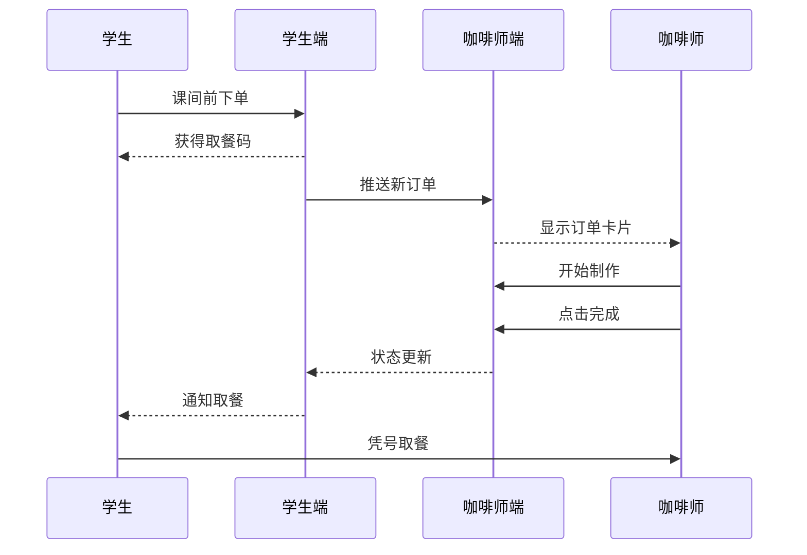

# 产品需求规格与操作手册 (Product Specification & Manual)

本文档包含完整的 PRD (产品需求) 以及操作手册。

---

## 1. 产品概述 (PRD)

### 1.1 背景与目标
- **痛点**: 高中课间休息仅 10-15 分钟，咖啡厅排队严重
- **方案**: "线上下单、到店即取" 的 KDS 系统

### 1.2 核心流程



### 1.3 用户角色

| 角色 | 终端 | 核心能力 |
|------|------|---------|
| 🎓 **学生** | Mobile/iPad | 菜单浏览、下单支付、订单追踪 |
| ☕ **咖啡师** | Admin/iPad | KDS 接单、库存管理 |
| 👑 **管理员** | Admin/PC | 用户/商品/财务管理 |

---

## 2. 咖啡师操作手册 (Barista Manual)

### 2.1 界面导航

| 模块 | 图标 | 用途 |
|------|------|------|
| Dashboard | 📊 | 运营监控 |
| Orders | 📝 | **KDS 主界面** |
| Products | ☕ | 菜单管理 |
| Users | 👥 | 会员管理 |
| Finance | 💰 | 财务分析 |

### 2.2 KDS 订单管理

#### 筛选器
- **待处理** (默认): 显示 `已支付` + `制作中` 订单
- **已完成**: 历史记录查询

#### 订单卡片信息
| 区域 | 内容 |
|------|------|
| 左侧 | 取餐号 (大字体 **#A001**) |
| 中部 | 客户名、下单时间、金额 |
| 右侧 | 【完成订单】按钮 |

> [!TIP]
> 黄色背景 = 待制作，绿色背景 = 已完成

#### 订单详情
点击卡片查看：
- 饮品列表 (带图片)
- **规格标签**: `去冰` `半糖` `燕麦奶` (灰色胶囊，防止做错)
- 总价

### 2.3 商品管理

| 操作 | 方法 |
|------|------|
| **一键沽清** | 编辑商品 → 点击红色【设为售罄】 |
| **恢复库存** | 编辑商品 → 点击绿色【恢复库存】(重置为 999) |
| **店长推荐** | 勾选 "Recommend"，首页 Banner 展示 |

### 2.4 财务操作

#### 会员充值
1. 用户管理 → 找到学生 → 点击钱包图标
2. 选择金额 (¥50/¥100) 或自定义
3. 确认 → 实时到账

#### 流水导出
财务分析 → 【导出】 → 生成 CSV 文件

---

## 3. 标准作业流程 (SOP)

### 开市准备
```
1. 登录 Admin → 检查 Dashboard 连接状态
2. 进入 Product Manager → 检查原料库存
3. 缺货商品 → 点击【设为售罄】
```

### 高峰期接单
```
1. 停留在 Order Manager (待处理视图)
2. 新订单滑入 → 点击查看详情
3. 大声核对规格 ("拿铁，去冰半糖！")
4. 制作 → 点击【完成订单】→ 叫号
```

### 异常处理
| 问题 | 解决方案 |
|------|---------|
| 网络断连 | 检查 Wi-Fi → 点击【刷新】→ 备用 4G 热点 |
| 错单退款 | 记录单号 → 用户管理手动充值退款金额 |

---

## 4. 学生端功能

| 功能 | 说明 |
|------|------|
| 极简点单 | 首页即菜单，大图展示 |
| 智能规格 | 冷/热选择，自动计算加价 |
| 排队感知 | 显示 "前方还有 N 单" |
| 余额支付 | 支付前校验余额 |

---

## 5. FAQ

| 问题 | 答案 |
|------|------|
| Dashboard 数据不更新 | 系统每 2 秒轮询，断网显示红色提示，点击【重试】 |
| 图片上传失败 | 检查大小 ≤ 5MB，格式 jpg/png/webp |
| 如何退款 | 用户管理 → 手动充值对应金额 (备注原因) |
