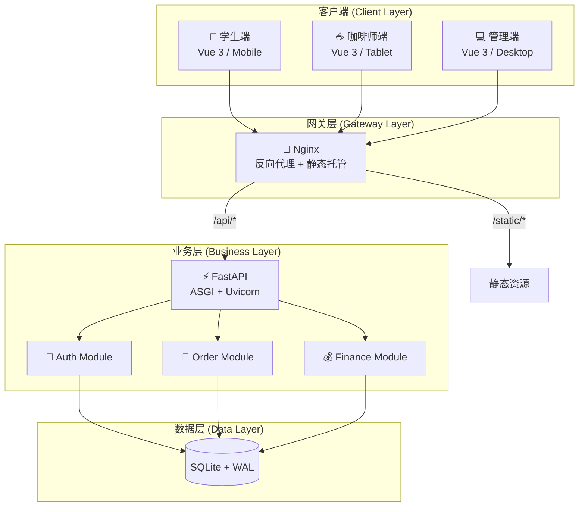
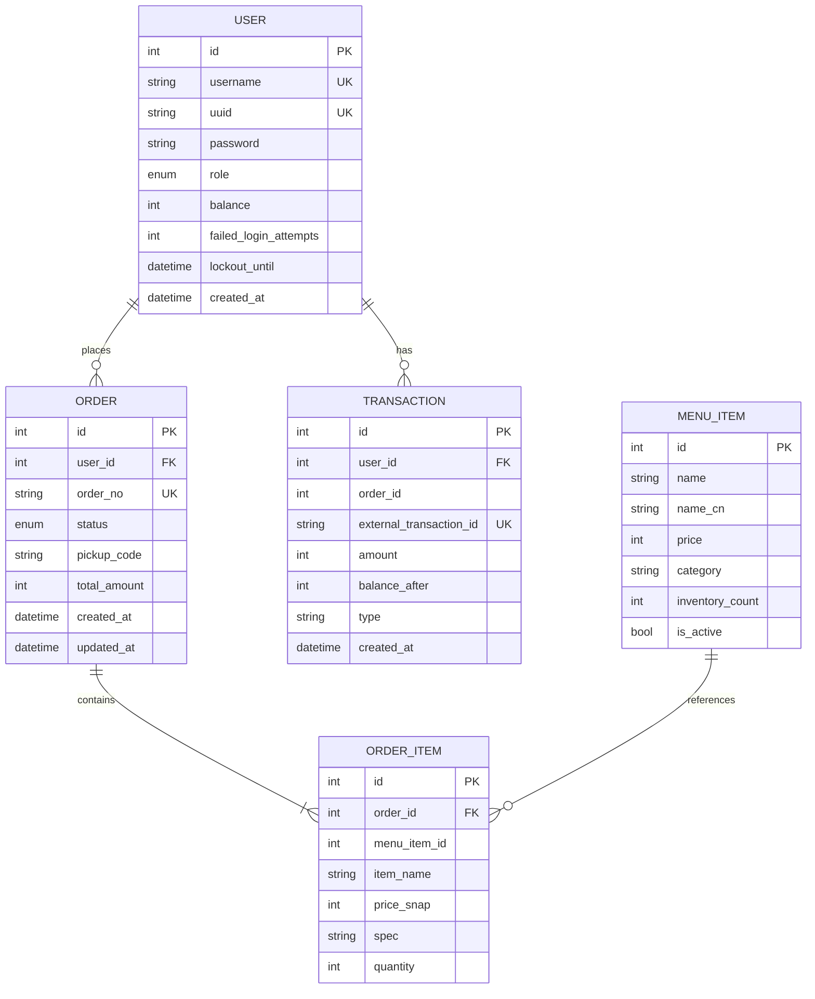
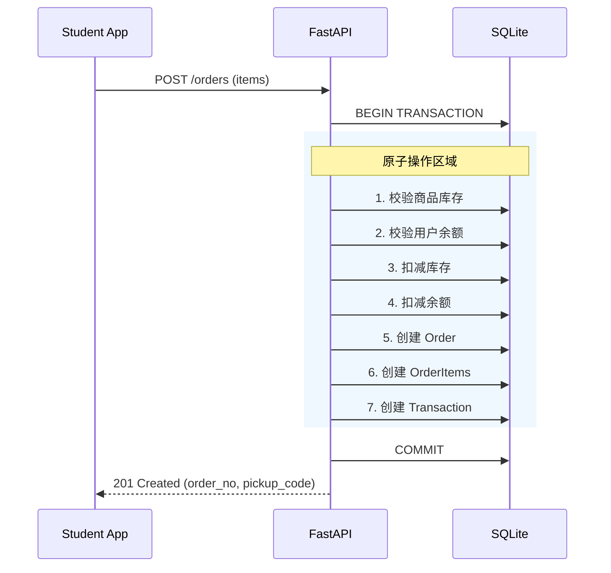
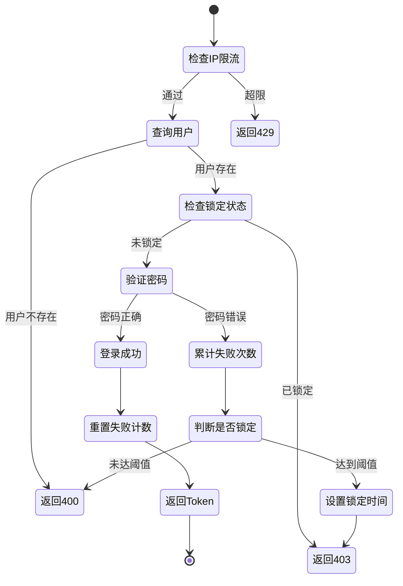
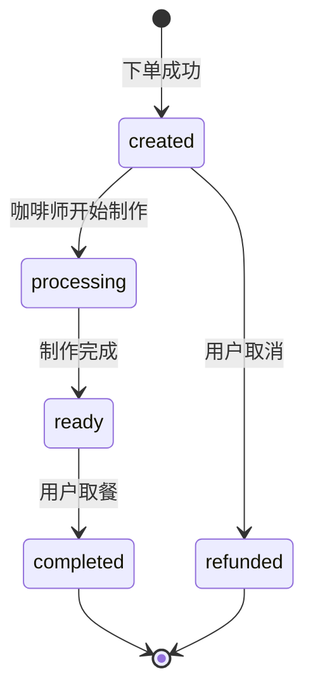

# 系统架构与技术参考手册 (System Architecture & Technical Reference)

本文档对应项目的技术层设计，包含架构概览、技术选型、数据库设计、核心模块实现细节及部署指南。

## 1. 架构设计文档 (Architecture Design)

### 1.1 架构总览
系统采用 B/S (Browser/Server) 架构，遵循前后端分离原则。



### 1.2 层级职责

| 层级 | 组件 | 职责 |
|-----|------|-----|
| **表现层** | Vue 3 Apps | UI 渲染、用户交互、API 调用 |
| **网关层** | Nginx | SSL 终结、路由分发、静态资源托管、GZIP 压缩 |
| **业务层** | FastAPI | 业务逻辑、认证授权、数据校验 |
| **数据层** | SQLite | 数据持久化、事务管理 |

---

## 2. 技术选型文档 (Tech Stack)

| 模块 | 技术栈 | 版本 | 选型理由 |
|-----|--------|-----|---------|
| **前端框架** | Vue 3 + Vite | 3.4+ | Composition API、毫秒级 HMR |
| **UI 样式** | Tailwind CSS | 3.x | 原子化 CSS、快速开发 |
| **状态管理** | Pinia | 2.x | 轻量、TypeScript 友好 |
| **图表库** | Chart.js | 4.x | 轻量、响应式 |
| **后端框架** | FastAPI | 0.100+ | 异步支持、自动 OpenAPI |
| **ORM** | SQLModel | 0.0.14+ | Pydantic + SQLAlchemy 融合 |
| **数据库** | SQLite | 3.x | 零配置、WAL 模式支持并发 |
| **认证** | JWT + bcrypt | - | 无状态、安全哈希 |
| **容器化** | Docker Compose | 2.x | 一键部署 |

---

## 3. 数据库设计 (Database Schema)

### 3.1 ER 关系图



### 3.2 核心表说明

#### User (用户表)
- **安全字段**: `failed_login_attempts`, `lockout_until` 实现渐进式锁定
- **余额**: 以"分"为单位存储，避免浮点精度问题
- **角色**: `student` | `barista` | `admin`

#### Order (订单表)
- **状态机**: `created` → `processing` → `ready` → `completed`
- **索引优化**: 复合索引 `(status, created_at)` 加速 KDS 查询
- **取餐码**: 每日重置的流水号

#### OrderItem (订单明细 - 快照模式)
- **价格快照**: `price_snap` 防止菜单变更影响历史账单
- **规格存储**: JSON 格式 `{"sugar": "half", "temp": "ice"}`

#### Transaction (资金流水)
- **类型**: `order` (消费)、`deposit` (充值)、`refund` (退款)
- **余额快照**: `balance_after` 便于财务核对

---

## 4. 核心业务流程 (Business Logic)

### 4.1 订单创建流程



### 4.2 认证与锁定流程



### 4.3 订单状态流转



---

## 5. API 路由组织

```
/api/v1
├── /login
│   └── POST /access-token     # 登录
├── /users
│   ├── GET  /me               # 获取当前用户
│   ├── PUT  /me               # 更新个人信息
│   └── PUT  /me/password      # 修改密码
├── /menu
│   └── GET  /                 # 获取菜单
├── /orders
│   ├── POST /                 # 创建订单
│   ├── GET  /history          # 订单历史
│   ├── POST /{id}/cancel      # 取消订单
│   ├── POST /{id}/complete    # 完成订单
│   ├── GET  /sync             # KDS 增量同步
│   └── PUT  /{id}/status      # 更新状态
├── /admin
│   ├── GET  /stats            # Dashboard 数据
│   ├── CRUD /users            # 用户管理
│   ├── CRUD /products         # 商品管理
│   └── CRUD /orders           # 订单管理
├── /finance
│   ├── GET  /stats            # 财务概览
│   ├── GET  /chart            # 图表数据
│   └── GET  /transactions     # 交易流水
└── /settings
    ├── GET  /                 # 获取设置
    └── PUT  /{key}            # 更新设置
```

---

## 6. Docker 部署指南 (Deployment)

### 6.1 目录结构

```bash
CoffeeOrder/
├── backend/
│   ├── app/               # FastAPI 应用
│   ├── data/              # 数据目录 (挂载点)
│   │   └── coffee.db      # SQLite 数据库
│   ├── Dockerfile
│   └── requirements.txt
├── frontend/
│   ├── Student/           # 学生端
│   ├── Admin/             # 管理端
│   └── Barista/           # 咖啡师端
├── docker-compose.yml
└── .env                   # 环境变量
```

### 6.2 环境变量 (.env)

```bash
# 安全配置 (生产环境必须修改!)
SECRET_KEY=your-super-secret-key-change-in-production

# 数据库
DATABASE_URL=sqlite+aiosqlite:///./data/coffee.db

# Token 配置
ACCESS_TOKEN_EXPIRE_MINUTES=1440
```

### 6.3 常用命令

```bash
# 一键启动
docker-compose up --build -d

# 查看日志
docker-compose logs -f backend

# 进入容器
docker-compose exec backend bash

# 数据库迁移
docker-compose exec backend alembic upgrade head

# 停止服务
docker-compose down
```

### 6.4 端口映射

| 端口 | 服务 | 用途 |
|-----|------|-----|
| `80` | Nginx | 生产入口 |
| `8000` | FastAPI | API + Swagger (/docs) |
| `5173` | Vite (Dev) | Student 开发服务器 |
| `5174` | Vite (Dev) | Admin 开发服务器 |
| `5175` | Vite (Dev) | Barista 开发服务器 |

---

## 7. 性能优化策略

### 7.1 数据库优化
- **WAL 模式**: 读写分离，提升并发性能
- **复合索引**: `(status, created_at)` 加速 KDS 查询
- **连接池**: SQLAlchemy async 连接池

### 7.2 前端优化
- **轮询策略**: 2秒间隔，局域网低延迟
- **Vite 构建**: Tree-shaking + 代码分割
- **静态压缩**: Nginx GZIP

### 7.3 未来规划
- WebSocket 替代轮询 (v1.1)
- Redis 缓存热点数据 (v1.2)
- PostgreSQL 迁移 (生产规模化)
